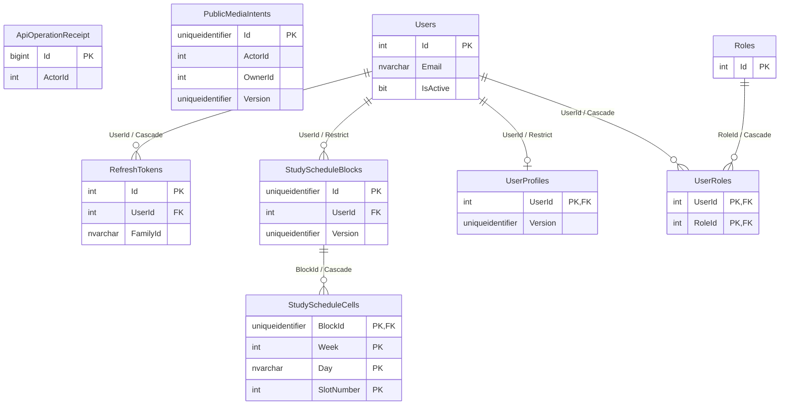
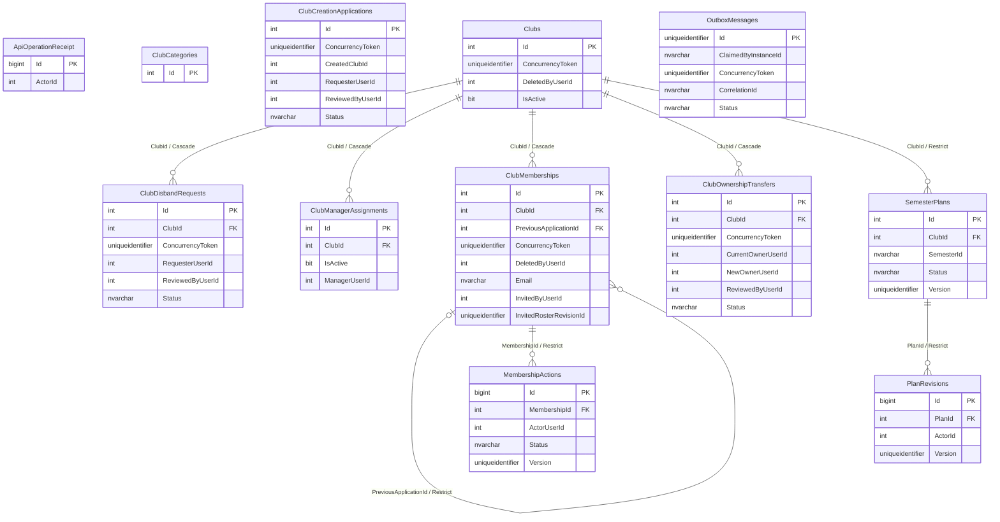
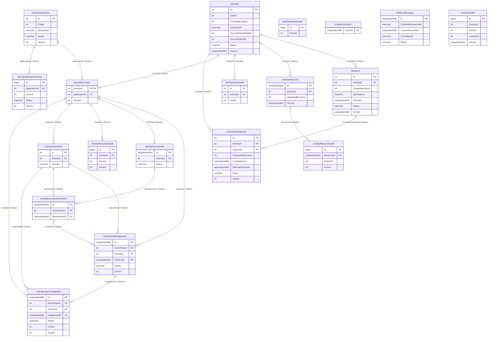
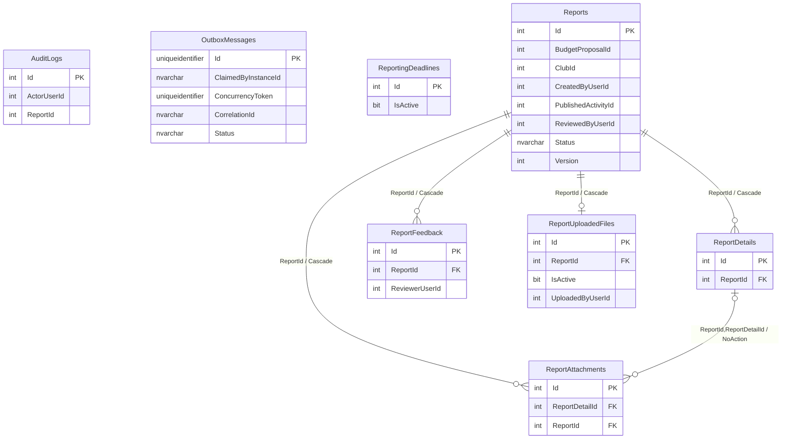
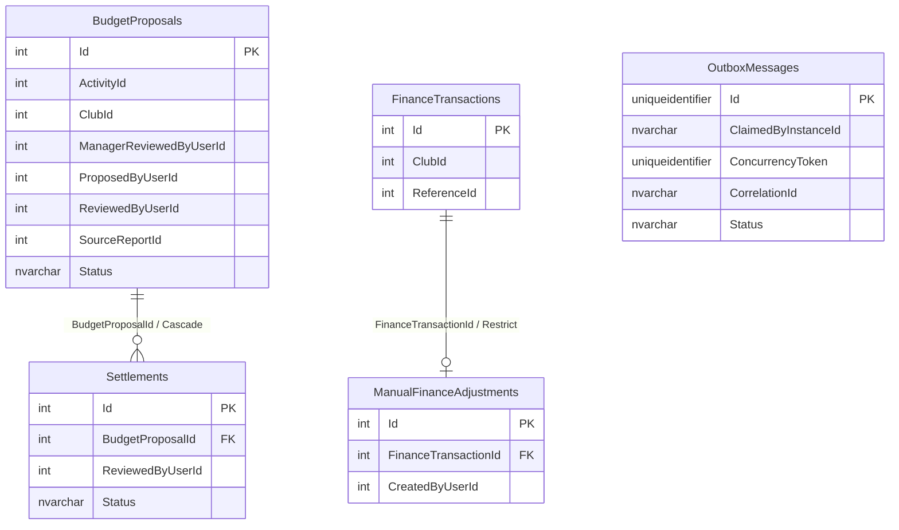
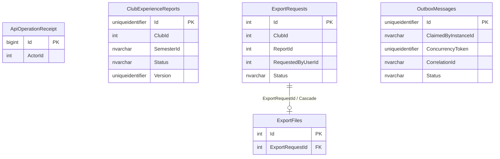
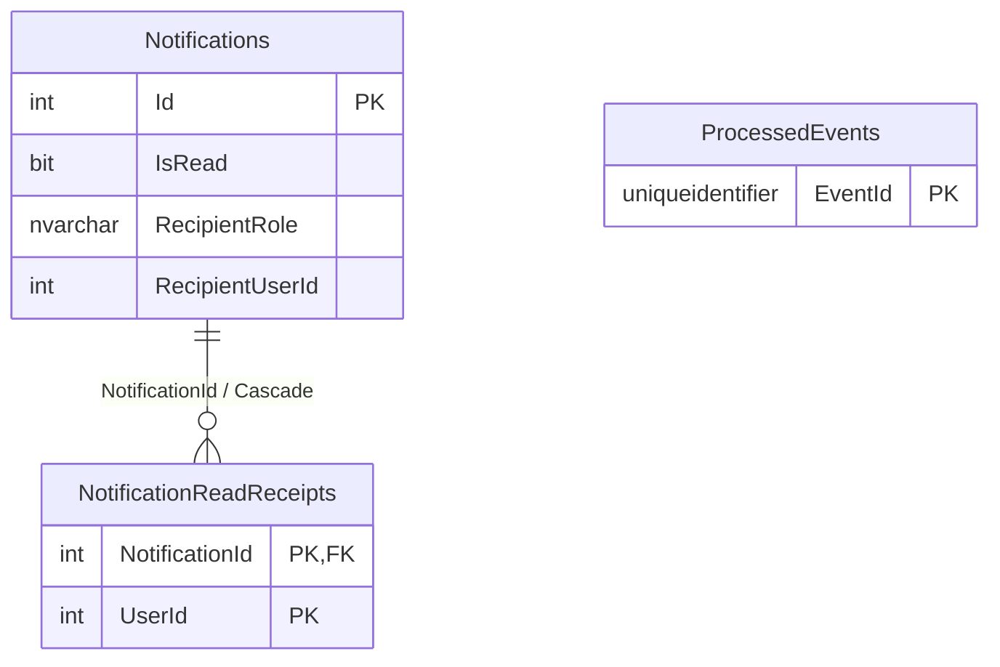

# ERD từ model EF — cập nhật sau triển khai 27/10/2026

Model hiện tại: **92 bảng, 61 FK, 169 index, 70 migration** trong 8 DbContext. Đây là model trong source, không phải dump production. Không tính bảng nội bộ Hangfire hoặc __EFMigrationsHistory.

[Báo cáo triển khai và kiểm chứng](TRIEN_KHAI_ERD_DATABASE_2026-10-27.md) · [Data dictionary đầy đủ](ERD_EF_DATABASE_2026-10-26.json).

PK/FK chỉ gắn khi EF khai báo. Các cột UserId/ClubId xuyên database có thể là logical reference; các đường nối chỉ là FK nội bộ. Sơ đồ chỉ hiển thị key và một số cột định danh/trạng thái; JSON có toàn bộ cột, SQL type/nullability/index/filter/INCLUDE/concurrency.

Report migration hiện tự tạo đủ 12 cột cũ; Receipt là bảng mới. TargetRevisionId vẫn đa loại, không được vẽ thành FK cố định tới revision.

## Auth — 9 bảng, 6 FK

## Club — 12 bảng, 8 FK

## Activity — 19 bảng, 20 FK

## Admin — 31 bảng, 18 FK

```mermaid
erDiagram
    AcademicCalendarRevisions {
        uniqueidentifier Id PK
        uniqueidentifier CalendarId FK
        int ActorId
        uniqueidentifier Version
    }
    AcademicCalendars {
        uniqueidentifier Id PK
        uniqueidentifier SemesterId FK
        int UpdatedByUserId
        uniqueidentifier Version
    }
    ApiOperationReceipt {
        bigint Id PK
        int ActorId
    }
    ApprovedExperiencePolicies {
        uniqueidentifier Id PK
        uniqueidentifier BenchmarkId FK
        nvarchar SemesterId
    }
    AuditRecords {
        uniqueidentifier Id PK
        nvarchar ActorSubjectId
        nvarchar CorrelationId
        nvarchar ResourceId
    }
    BonusMatrixNodes {
        uniqueidentifier Id PK
    }
    ContributionDecisions {
        uniqueidentifier Id PK
        uniqueidentifier ContributionId FK
        uniqueidentifier RevisionId FK
        uniqueidentifier AssignmentId
        int ReviewerUserId
        uniqueidentifier TargetRevisionId
    }
    ContributionEvidence {
        uniqueidentifier Id PK
        int OwnerUserId
    }
    ContributionRevisions {
        uniqueidentifier Id PK
        uniqueidentifier ContributionId FK
        int ActorId
        nvarchar Status
    }
    Contributions {
        uniqueidentifier Id PK
        int ActivityId
        int AttendanceId
        int ClubId
        uniqueidentifier CurrentRevisionId
        nvarchar SemesterId
        int SessionId
        nvarchar SourceId
    }
    ContributionUpgradeRequests {
        uniqueidentifier Id PK
        uniqueidentifier ContributionId FK
        nvarchar Status
        uniqueidentifier Version
    }
    ExperienceInbox {
        uniqueidentifier EventId PK
    }
    ExperienceLedgerAllocations {
        bigint Id PK
        bigint EffectId FK
    }
    ExperienceLedgerEffects {
        bigint Id PK
        uniqueidentifier ContributionId FK
        uniqueidentifier RevisionId FK
        uniqueidentifier EventId
        nvarchar SemesterId
        int UserId
        uniqueidentifier VerificationId
        int VerifiedByUserId
    }
    InvalidatedExperienceSources {
        bigint Id PK
        int ActivityId
        int ActorId
        int SessionId
    }
    ManualAttendanceRequests {
        uniqueidentifier Id PK
        int ActivityId
        int ClubId
        uniqueidentifier ContributionId
        int SessionId
        nvarchar Status
        int UserId
        uniqueidentifier Version
    }
    OutboxMessages {
        uniqueidentifier Id PK
        nvarchar ClaimedByInstanceId
        uniqueidentifier ConcurrencyToken
        nvarchar CorrelationId
        nvarchar Status
    }
    PlatformSettings {
        uniqueidentifier Id PK
    }
    QuestCompletionRecords {
        uniqueidentifier Id PK
        uniqueidentifier ParticipantId FK
    }
    QuestParticipants {
        uniqueidentifier Id PK
        uniqueidentifier QuestId FK
        nvarchar Status
        int StudentUserId
        uniqueidentifier Version
    }
    Quests {
        uniqueidentifier Id PK
        int CreatedByUserId
        nvarchar Status
        uniqueidentifier Version
    }
    SelfDeclarations {
        uniqueidentifier Id PK
        int ClubId
        int ReviewedByUserId
        nvarchar Status
        int StudentId
    }
    SemesterBenchmarkConfigs {
        uniqueidentifier Id PK
        int ApprovedByUserId
        int CreatedByUserId
        bit IsActive
        int LockedByUserId
        uniqueidentifier Version
    }
    SemesterRoster {
        uniqueidentifier Id PK
        uniqueidentifier SemesterId FK
        uniqueidentifier RevisionId
        uniqueidentifier Version
    }
    SemesterRosterImport {
        uniqueidentifier Id PK
        uniqueidentifier SemesterId FK
        int ActorId
    }
    SemesterRosterRevision {
        uniqueidentifier Id PK
        uniqueidentifier ImportId FK
        uniqueidentifier RosterId FK
        uniqueidentifier SourceRevisionId FK
        int ActorId
        uniqueidentifier Version
    }
    SemesterRosterRow {
        bigint Id PK
        uniqueidentifier RevisionId FK
        nvarchar Email
        int UserId
    }
    Semesters {
        uniqueidentifier Id PK
        bit IsActive
    }
    VerificationAssignments {
        uniqueidentifier Id PK
        int ClubId
        int UserId
        uniqueidentifier Version
    }
    XpAnomalies {
        uniqueidentifier Id PK
        nvarchar Status
        int StudentUserId
    }
    XpLedgerEntries {
        uniqueidentifier Id PK
        uniqueidentifier RelatedAnomalyId
        int StudentUserId
    }
    AcademicCalendars ||--o{ AcademicCalendarRevisions : "CalendarId / Restrict"
    Semesters ||--o{ AcademicCalendars : "SemesterId / Restrict"
    SemesterBenchmarkConfigs ||--o{ ApprovedExperiencePolicies : "BenchmarkId / Restrict"
    Contributions ||--o{ ContributionDecisions : "ContributionId / Restrict"
    ContributionRevisions ||--o{ ContributionDecisions : "ContributionId,RevisionId / Restrict"
    Contributions ||--o{ ContributionRevisions : "ContributionId / Restrict"
    Contributions ||--o{ ContributionUpgradeRequests : "ContributionId / Restrict"
    ExperienceLedgerEffects ||--o{ ExperienceLedgerAllocations : "EffectId / Restrict"
    Contributions ||--o{ ExperienceLedgerEffects : "ContributionId / Restrict"
    ContributionRevisions ||--o{ ExperienceLedgerEffects : "ContributionId,RevisionId / Restrict"
    QuestParticipants ||--o{ QuestCompletionRecords : "ParticipantId / Restrict"
    Quests ||--o{ QuestParticipants : "QuestId / Cascade"
    Semesters ||--o{ SemesterRoster : "SemesterId / Restrict"
    Semesters ||--o{ SemesterRosterImport : "SemesterId / Restrict"
    SemesterRosterImport |o--o{ SemesterRosterRevision : "ImportId / Restrict"
    SemesterRoster ||--o{ SemesterRosterRevision : "RosterId / Restrict"
    SemesterRosterRevision |o--o{ SemesterRosterRevision : "SourceRevisionId / Restrict"
    SemesterRosterRevision ||--o{ SemesterRosterRow : "RevisionId / Restrict"
```

## Report — 8 bảng, 5 FK

## Finance — 5 bảng, 2 FK

## Export — 5 bảng, 1 FK

## Notification — 3 bảng, 1 FK

