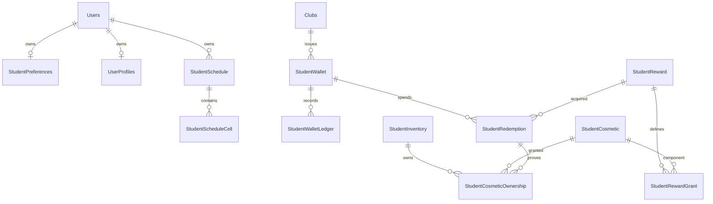

# Student data DB design v1

Status: proposed schema, not an applied migration. SQL Server/EF Core design for [student-data-consistency-v1.md](student-data-consistency-v1.md). Physical names requested by the user use hyphens; map explicitly with `ToTable("student-preferences")`, etc., and bracket identifiers in SQL. Schema `dbo`; do not emit unquoted hyphenated identifiers.

Two database owners: AuthService owns preferences/schedules; ClubService owns wallet/catalog/inventory. AdminService retains academic semester/roster and XP ledger. GUIDs are `uniqueidentifier`, integer identities retain existing `int`, timestamps `datetimeoffset(7)`, text Unicode `nvarchar`. Monetary SQL types are not used for club credits.

## AuthService

### dbo.[student-preferences] — one row per student

| Column | SQL type/null | Constraint/meaning |
| --- | --- | --- |
| UserId | int NOT NULL | PK; FK Users.Id, ON DELETE NO ACTION. |
| Version | uniqueidentifier NOT NULL | Nonempty GUID, server-issued EF concurrency token. |
| SchemaVersion | int NOT NULL | Default 1; positive. |
| DeclaredMajor | nvarchar(120) NULL | Student declaration; not roster major. |
| DeclaredCohortLabel | nvarchar(30) NULL | Student declaration; e.g. K20. |
| InterestIdsJson | nvarchar(2000) NOT NULL | Default `[]`; ISJSON; application validates known ID array. |
| CustomInterestsJson | nvarchar(max) NOT NULL | Default `[]`; ISJSON and DATALENGTH <=65536 (including serializer escaping); combined max 30 items, each <=100. |
| SyncTimetable | bit NOT NULL | Default 0; intent only. |
| OnboardingStatus | varchar(12) NOT NULL | DRAFT or COMPLETED. |
| CompletedVersion | int NULL | Positive required onboarding schema version at first completion. |
| CompletedAtUtc | datetimeoffset(7) NULL | Server receipt time. |
| CreatedAtUtc | datetimeoffset(7) NOT NULL | Server time. |
| UpdatedAtUtc | datetimeoffset(7) NOT NULL | Server time >= CreatedAtUtc. |

CHECK completion consistency: DRAFT implies both completion fields NULL; COMPLETED implies timestamp NOT NULL and CompletedVersion >=1. Do not enforce current major/interests for completed rows at DB level because users may edit preferences after completion. Completion validation is transactional command logic. No separate email/campus/studentCode/contacts copy. PK UserId suffices for own read; optional operations index `(OnboardingStatus,UpdatedAtUtc)` only if an authorized operational query needs it.

JSON is bounded and schema-validated by BE, never treated as arbitrary client metadata. Interests do not currently need relational search; a future search/recommendation index is a rebuildable projection, not a second owner.

### Profile coupling

Existing `CanonicalUserProfile` maps to `UserProfiles`. Keep its fields/PK/FK except deprecate `InterestsJson` after backfill. Self-profile and internal member DTOs project interests from preferences. `student-preferences` and `UserProfiles` share an AuthService transaction and optimistic version checks. Their UserId keys refer to the same `Users.Id`; no extra preference-profile FK that would require profile creation on a GET.

Global lock order for commands touching both: account, UserProfiles, student-preferences; when missing, handle insert uniqueness races by rolling back and returning a stale conflict. Use the same order in completion, preferences PATCH and profile-interest PATCH. Backfill/create an actual canonical profile if needed for a write; its initial expected version is empty GUID.

### dbo.[student-schedule] — aggregate header, migrated existing table

| Column | SQL type/null | Constraint/meaning |
| --- | --- | --- |
| Id | uniqueidentifier NOT NULL | PK; preserve existing StudyScheduleBlocks.Id. |
| UserId | int NOT NULL | FK Users.Id, NO ACTION. |
| Year | int NOT NULL | CHECK 2000..2100; route alias. |
| Term | varchar(2) NOT NULL | CHECK SP/SU/FA. |
| Block | varchar(3) NOT NULL | CHECK 10W/3W. |
| SemesterKey | uniqueidentifier NOT NULL | Existing official Admin semester GUID; logical cross-service reference, no SQL FK. |
| CalendarVersion | uniqueidentifier NOT NULL | Last successful write's source version, not copied calendar dates. |
| Version | uniqueidentifier NOT NULL | Existing nonempty concurrency GUID. |
| UpdatedAtUtc | datetimeoffset(7) NOT NULL | Existing mutation timestamp. |

Unique `(UserId,Year,Term,Block)` preserves current route identity. Index `(UserId,SemesterKey,Block)` supports official-period lookup; make unique only after migration reconciliation proves each alias is stable and no duplicate official blocks exist. Do not add a second writable schedule key at runtime. Alias reassignment must be rejected for populated schedules or handled as an explicit audited data migration; never silently display old cells under a different semester.

### dbo.[student-schedule-cell] — normalized weekly cells

| Column | SQL type/null | Constraint/meaning |
| --- | --- | --- |
| ScheduleId | uniqueidentifier NOT NULL | FK student-schedule.Id, CASCADE; migrate BlockId name only. |
| Week | int NOT NULL | CHECK 1..10; 3W upper bound validated against header. |
| Day | varchar(3) NOT NULL | CHECK mon/tue/wed/thu/fri/sat/sun. |
| SlotNumber | int NOT NULL | CHECK 1..7; 10W upper bound 5 validated against header. |
| Subject | nvarchar(120) NOT NULL | Trimmed nonblank, no controls. |
| Room | nvarchar(80) NOT NULL | Default empty string. |
| UpdatedAtUtc | datetimeoffset(7) NOT NULL | Server time. |

Composite PK `(ScheduleId,Week,Day,SlotNumber)`; no duplicate cell and no second per-cell version. The header's version protects every mutation/bulk import. SQL CHECK cannot inspect a parent row; block-specific week/slot limits are mandatory application/transaction validation (or a tested trigger if implemented), not falsely claimed as cross-table CHECKs.

## ClubService

### dbo.[student-wallet] — canonical balance projection

| Column | SQL type/null | Constraint/meaning |
| --- | --- | --- |
| Id | uniqueidentifier NOT NULL | PK. |
| UserId | int NOT NULL | Auth identity logical reference; no FK across DBs. |
| ClubId | int NOT NULL | FK Clubs.Id, NO ACTION; retain issuing club/history. |
| Unit | varchar(16) NOT NULL | CHECK CLUB_CREDIT. |
| Balance | bigint NOT NULL | Default 0; may become negative on reversal. |
| EarnedTotal | bigint NOT NULL | Default 0, >=0. |
| RevokedTotal | bigint NOT NULL | Default 0, >=0. |
| SpentTotal | bigint NOT NULL | Default 0, >=0. |
| LastEntrySequence | bigint NOT NULL | Default 0, >=0. |
| Version | uniqueidentifier NOT NULL | Nonempty concurrency token. |
| CreatedAtUtc, UpdatedAtUtc | datetimeoffset(7) NOT NULL | Server times. |

Unique `(UserId,ClubId)`; fixed unit avoids parallel currencies. `CHECK Balance = EarnedTotal - SpentTotal - RevokedTotal`, evaluated with decimal(38,0) casts to avoid SQL bigint overflow in the constraint expression. Add CHECKs bounding absolute balance and all counters to 9007199254740991 for exact JSON integer transport; same bounds apply to ledger amounts/balanceAfter/sequence and receipt prices. Application arithmetic uses checked 64-bit integers; summation/reconciliation uses decimal(38,0). No `Balance >= 0` constraint: debt after source reversal is valid. All totals are a synchronous rebuildable projection of immutable ledger, never a separate source of credits.

### dbo.[student-wallet-ledger] — append-only effects

| Column | SQL type/null | Constraint/meaning |
| --- | --- | --- |
| Id | uniqueidentifier NOT NULL | PK. |
| WalletId | uniqueidentifier NOT NULL | FK student-wallet.Id, NO ACTION. |
| Sequence | bigint NOT NULL | Per-wallet positive monotonic value. |
| EntryType | varchar(12) NOT NULL | CREDIT, DEBIT or REVERSAL. |
| Amount | bigint NOT NULL | CREDIT >0, DEBIT/REVERSAL <0; never zero. |
| BalanceAfter | bigint NOT NULL | Balance immediately after effect. |
| SourceNamespace | varchar(64) NOT NULL | Trusted producer namespace. |
| SourceKey | nvarchar(200) NOT NULL | Immutable business event/award/redemption identity. |
| SourceRevision | nvarchar(64) NOT NULL | Immutable revision or canonical receipt reference. |
| SemesterId | nvarchar(40) NULL | Official code captured for earning/reversal reporting. |
| PolicyVersion | uniqueidentifier NULL | Required credit policy version on CREDIT; original policy on REVERSAL. |
| PolicySnapshotJson | nvarchar(max) NULL | Immutable approved credit-policy snapshot for CREDIT/REVERSAL; ISJSON when nonnull. |
| SourceSnapshotJson | nvarchar(max) NOT NULL | ISJSON; bounded allowlisted source/award/receipt facts captured by server, excludes evidence URLs and private profile data. |
| ReversesEntryId | uniqueidentifier NULL | FK same ledger.Id, NO ACTION; REVERSAL only. |
| CorrelationId | uniqueidentifier NOT NULL | Receipt/event correlation. |
| ActorUserId | int NULL | Human reviewer when relevant; trusted system command may be null. |
| Reason | nvarchar(1000) NOT NULL | Required audit reason; no private evidence URLs. |
| OccurredAtUtc, RecordedAtUtc | datetimeoffset(7) NOT NULL | Source time vs committed processing time. |

Unique `(WalletId,Sequence)`, unique `(WalletId,SourceNamespace,SourceKey,SourceRevision,EntryType)`, filtered unique `ReversesEntryId WHERE ReversesEntryId IS NOT NULL`. Index `(WalletId,SemesterId,Sequence DESC)`; ledger paging uses wallet sequence. SQL types/lengths must keep composite index keys within provider limits. Require a bounded ASCII namespace and canonical, case-consistent source identity; do not let collation differences create alternate identities.

CHECK type/sign and REVERSAL iff ReversesEntryId nonnull. Transaction logic additionally requires referenced entry in the same wallet, original type CREDIT, exact opposite original amount (excluding bigint minimum overflow), original semester/policy preserved and no second reversal. A debit is generated only from a redemption receipt. Reject UPDATE/DELETE in DbContext and restrict application DB access; retain ledger/receipts on account/club archival.

### dbo.[student-wallet-inbox] — durable external award receipt

`(Producer varchar(64), EventId uniqueidentifier)` PK; `PayloadHash binary(32)`, `BusinessKey nvarchar(200)`, `WalletId GUID`, `LedgerEntryId GUID`, `ProcessedAtUtc datetimeoffset`, `Outcome varchar(16)`. Both IDs FK their ClubService aggregates, NO ACTION. Unique `(Producer,BusinessKey)` prevents different events from minting the same award twice. Canonical business key includes award revision when a corrected award legitimately reissues credit. Store only successfully committed processing; retry/dead-letter state belongs to transport, not a fake credit receipt. Keep identity/hash permanently or archive with uniqueness still enforced.

Reuse existing `ApiOperationReceipts` for public command replay, rather than introducing a competing idempotency table. Reuse ClubService `OutboxMessages` for committed notifications/source acknowledgments. Source award records and policy snapshots must remain resolvable; retaining only a mutable source ID is insufficient.

### Atomic redemption dependencies — same ClubService DB

These are new supporting tables required for a real wallet; a balance table alone cannot safely implement redemption.

| Table | Minimum columns and constraints |
| --- | --- |
| student-reward | `Id GUID PK`, `ClubId int FK Clubs NO ACTION`, `Version GUID`, `Status DRAFT/PUBLISHED/RETIRED`, `Price bigint >=0` under policy max 100000, `Label nvarchar(80)`, `PublishedAtUtc?`, immutable published definition. |
| student-cosmetic | `Id GUID PK`, `IssuerClubId int FK Clubs NO ACTION`, `Kind COLOR/SHAPE`, immutable validated `DefinitionJson nvarchar(max) ISJSON`, verified asset reference nullable, `CreatedAtUtc`. No arbitrary executable SVG/URL in a grant. |
| student-reward-grant | `(RewardId GUID,CosmeticId GUID) PK`, FKs reward/cosmetic NO ACTION; nonempty controlled grant set, issuer match checked transactionally. Bundle is multiple component rows. |
| student-redemption | `Id GUID PK`, `WalletId GUID FK`, `RewardId GUID FK`, `RewardVersion GUID`, `PriceCharged bigint >=0`, `DebitEntryId GUID NULL FK ledger`, `CatalogSnapshotJson ISJSON`, `CreatedAtUtc`; unique `(WalletId,RewardId)`, filtered unique nonnull DebitEntryId. Price>0 iff debit nonnull; price 0 iff no debit. |
| student-inventory | `UserId int PK` logical auth reference, `Version GUID`, `UpdatedAtUtc`; aggregate lock/version for own inventory across clubs. |
| student-cosmetic-ownership | `(UserId int,CosmeticId GUID) PK`, FK UserId -> student-inventory and CosmeticId -> student-cosmetic, `SourceRedemptionId GUID FK`, `AcquiredAtUtc`; immutable grant, no duplicate ownership. |

Reward, source price, grants, debit and ownership are validated and committed with wallet mutation, idempotency receipt and outbox in a single transaction. Positive price debit amount must equal `-PriceCharged` and wallet must match; enforce transactionally because this crosses tables. Free claims still create redemption and ownership records but no ledger effect. Wallet version rotates for a successful new receipt, including a free claim; sequence changes only for ledger effects. Inventory version rotates only when ownership changes.

Lock order for redemption: club/membership, reward, wallet, inventory; component ownership checked under inventory lock. Award/reversal needs wallet lock; it does not acquire inventory after holding it elsewhere. Serialize missing-wallet/inventory creation with unique constraints/range locks and retry the full transaction. Membership/reward retirement must not race the final commit eligibility check. Do not rely on an in-memory mutex or only checking balance before opening a transaction.

All ownerships initially come from explicit server receipts; future automatic awards require their own typed grant-source receipt rather than nullable provenance. Common free UI styles do not need fabricated owned entitlements. Physical stock/refund/fulfillment tables are deferred.

## Relationships

Diagram names are readable aliases for the physical names above. No Users -> wallet FK is drawn because that identity resides in another database. Admin semester/calendar/XP references are likewise logical service references.

## Migration and backfill

### Preferences

1. Create table/checks/FK; do not modify existing profile/personal fields.
2. For each persisted `UserProfiles.InterestsJson`, map known canonical v1 labels/IDs to interestIds, preserve other valid labels in customInterests, deduplicate deterministically. Invalid/oversized rows are quarantined/reported for correction, never silently truncated or overwritten. Preserve a recoverable source snapshot during migration.
3. Existing interests do not prove onboarding completed. Set DRAFT with null receipt unless an existing authoritative server completion is available. Neither browser marker nor having three interests is a server completion receipt. Existing student input can prefill the new server-backed form.
4. Switch all canonical/internal profile readers and both preference/profile writers to the single owner; enforce preferences versions only after coordinated client release. Do not leave dual writes indefinitely. Remove legacy profile interests column in a later migration after parity checks.

### Schedule

1. Inventory existing headers/cells, duplicate keys/orphans, alias bindings and block bounds. Fix/quarantine exceptions explicitly before adding stricter constraints; no silent drop.
2. EF `RenameTable` StudyScheduleBlocks -> student-schedule and StudyScheduleCells -> student-schedule-cell; rename BlockId -> ScheduleId and associated index/FK names. Preserve all GUIDs, versions, cells, timestamps and existing relationships. Do not drop/recreate tables.
3. Reconcile index names, column SQL types and lengths explicitly; narrowing nvarchar to varchar for known enum fields requires validation before alteration. Existing SemesterKey remains GUID; preserve the current wire meaning.
4. Run old and new read parity queries by user/period/block, counts and checksums. Deploy service mappings with migration coordination to avoid old binaries querying renamed tables. A staged compatibility view is allowed only as a temporary read adapter, never a second writable owner. Rollback renames only while no incompatible schema/data writes have occurred; otherwise restore/forward-fix with a reviewed plan.

### Wallet

Create wallet, ledger, inbox, catalog and receipt/inventory tables in dependency order. Start zero real credits and empty real ownership. No demo/sample imports. Seed only explicitly approved server catalog definitions/policies, not student balances. Start consumer after constraints/idempotency are deployed; enable redemption only after conservation, concurrency and rollback tests pass. Never delete or rewrite committed ledger/receipt history as rollback; disable commands and reconcile/append authorized compensating operations.

## Migration proof to attach to implementation PR

SQL Server upgrade rehearsal on a copy with existing profiles/schedules; same ID/version/row counts; valid FK/check/index introspection; duplicate/first-write races; old profile client compatibility window; ledger totals and rollback tests; dead-letter/replay proof; query plans for own schedule/wallet and ledger paging. This design document alone neither creates production tables nor proves these checks passed.
